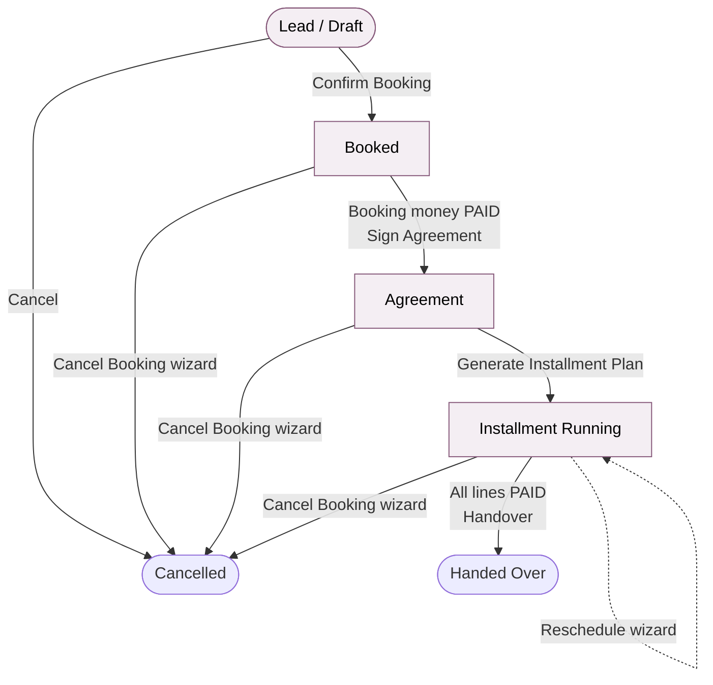
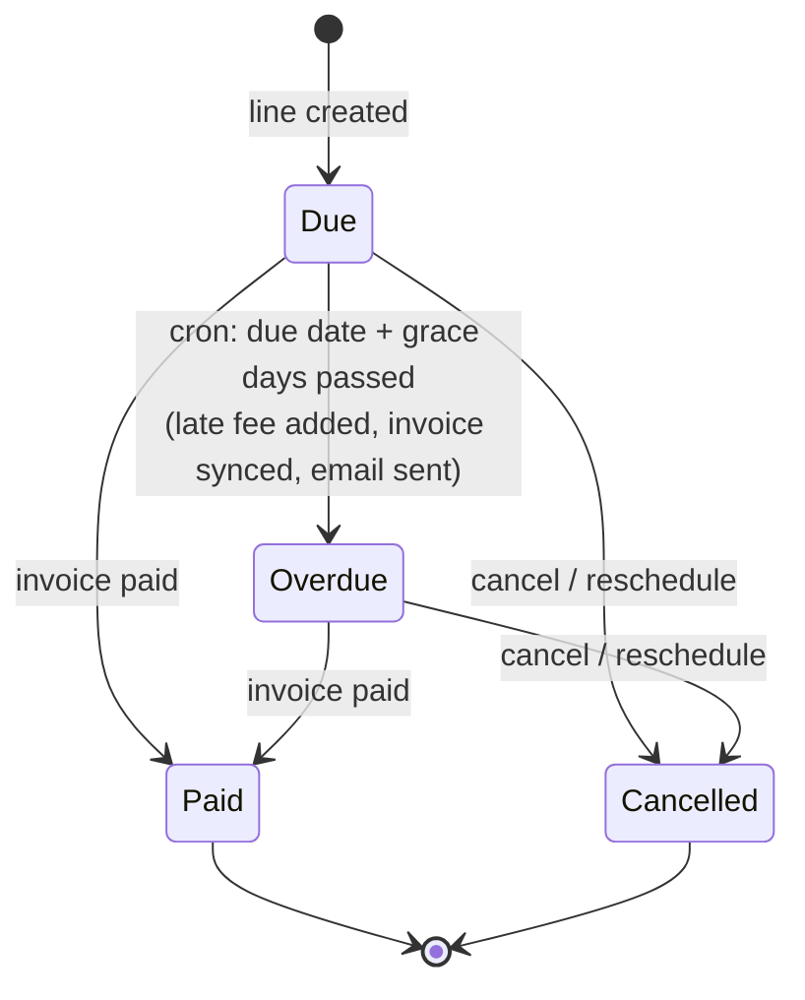
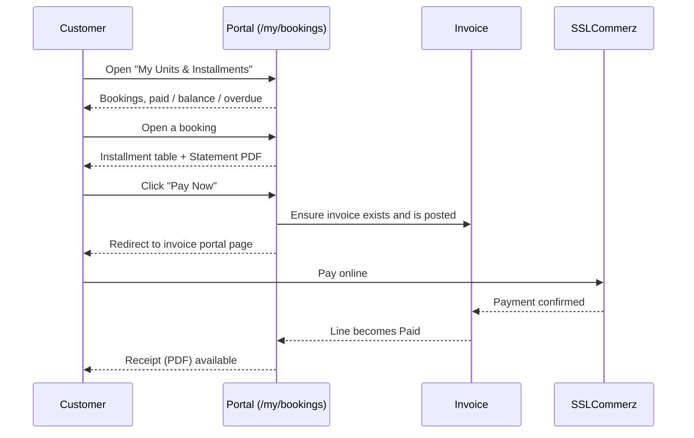
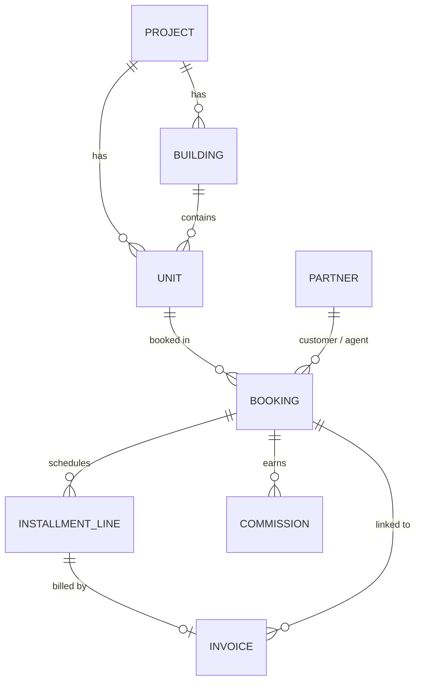

# Real Estate Installment & Property Sales Management

[](https://www.odoo.com)
[](https://www.gnu.org/licenses/lgpl-3.0)

An Odoo 19 module for developers and builders who sell **flats, plots and shops on installments**. It covers the full sales lifecycle: booking, agreement, installment plan, automatic late fees, email reminders, receipts, agent commissions, a customer portal, and online payment through **SSLCommerz**. [**[See Screenshots]**](#screenshots)

---

## Features

| Area | What you get |
|------|--------------|
| **Properties** | Projects → Buildings/Blocks → Units (Flat / Plot / Shop) with sizes in Sq. Ft., Katha or Decimal |
| **Booking** | Auto-numbered bookings (`BK/YYYY/00001`), pricing, discount, booking money, down payment, handover payment |
| **Installment plan** | One-click plan generation, with the last installment absorbing rounding differences |
| **Invoicing** | Every payment line gets a customer invoice, posted automatically |
| **Late fees** | Percentage-based fee applied once when a line becomes overdue, after a configurable grace period |
| **Reminders** | Daily cron sends an upcoming-due email, schedules an activity, and sends an overdue notice |
| **Receipts** | PDF payment receipts emailed automatically after payment |
| **Rescheduling** | Wizard that replaces pending installments with a new schedule |
| **Cancellation** | Wizard that releases the unit, cancels unpaid lines and commission, and calculates the refund |
| **Commission** | Agent commission is created at agreement, then goes through approval and payment |
| **Customer portal** | Customers see their units, installments and balance, then pay online and download statements and receipts |
| **Reports** | Booking Slip, Unit Statement, Payment Receipt (QWeb PDF) |
| **Analytics** | Pivot and graph views for bookings and installments |
| **Security** | Three-level role hierarchy with record rules |

---

## Workflow

### Booking lifecycle



| Step | Action | What happens automatically |
|------|--------|----------------------------|
| 1. **Draft** | Agent creates a booking: customer, unit, discount, booking money, payment schedule | Booking number is generated. The agent defaults to the current user if they are an agent. |
| 2. **Confirm Booking** | Validates price > 0 and booking money > 0 | Unit → `Booked`. A *Booking Money* line and invoice are created and posted. |
| 3. **Sign Agreement** *(Manager)* | Requires the booking money to be paid | Unit → `Sold`. Agreement date is stamped. Agent commission is created (rate from the agent's profile). |
| 4. **Generate Installment Plan** *(Manager)* | Builds Down Payment, N monthly Installments and Handover Payment | Dates are derived from the agreement date and interval. State → `Installment Running`. |
| 5. **Handover** *(Manager)* | Requires no `due` or `overdue` lines | State → `Handed Over`. Handover date is stamped. |
| ✖ **Cancel Booking** *(Manager)* | Wizard asks for reason and deduction % | Unpaid lines and their invoices are cancelled, unit → `Available`, open commissions are cancelled, and the refund is computed and logged. |
| **Reschedule** *(Manager)* | Wizard asks for new count, interval and first date | Pending installments are cancelled, along with their late fees, and replaced by a new set with the same total. |

### Installment line lifecycle



The line state is computed from the linked invoice's payment state, so paying through the portal, registering a payment in Accounting, or reconciling a bank statement all update it.

### Automation (scheduled actions)

| Cron | Interval | Job |
|------|----------|-----|
| `Installment reminders & overdue` | Daily | 1) Reminder email, activity and invoice for lines due within *N* days. 2) Mark lines past due plus grace as overdue, add the late fee, sync the invoice, email the customer and schedule an activity. |
| `Send payment receipts` | Every 15 min | Emails a PDF receipt for newly paid lines, up to 50 per run, and logs it in the booking chatter. |

Each line is processed inside its own savepoint, so one failure never blocks the rest.

### Customer portal flow



---

## Roles & Security

Roles are hierarchical. Each level inherits the one below it.

```
Manager  ──▶  Accountant  ──▶  Sales Agent  ──▶  Internal User
```

| Role | Can do |
|------|--------|
| **Sales Agent** | Create and edit own bookings, confirm drafts, view own installments and commissions, view properties |
| **Accountant** | See all bookings, installments and commissions. Create invoices, send reminders and receipts, waive late fees. |
| **Manager** | Everything: agreements, plans, handover, reschedule, cancel, commission approval, properties, settings |
| **Portal customer** | Read-only access to their own bookings and installments |

Record rules restrict agents and customers to their own records. The installment-pay and receipt portal routes rely on these rules. Report and invoice operations run with `sudo()` only after the access check.

The installer automatically adds the **Admin** user to the Real Estate Manager group.

---

## Configuration

**Real Estate → Configuration → Settings**

| Setting | Default | Meaning |
|---------|---------|---------|
| Late Fee (%) | `2.0` | Charged once on the installment amount when it becomes overdue |
| Grace Period (days) | `0` | Days after the due date before a line is marked overdue |
| Reminder (days before due) | `3` | Reminder email lead time |
| Cancellation Deduction (%) | `10.0` | Default deduction from the paid amount on cancellation |

Also, mark agents on their contact form under the **Real Estate** tab (*Real Estate Sales Agent* + *Commission Rate %*).

---

## Installation

### Requirements

- Odoo **19.0**
- Odoo apps: `base`, `mail`, `account`, `portal`, `payment`, `account_payment`
- An Odoo `payment_sslcommerz` provider module, available in your addons path

> The manifest depends on `payment_sslcommerz`. If you do not use SSLCommerz, remove it from `depends` in `__manifest__.py`. Everything else still works with any other payment provider.

### Steps

```bash
# 1. Clone into your custom addons directory
git clone https://github.com/TanvirAhmedCSE/real_estate_management.git /path/to/custom_addons/real_estate_management

# 2. Add the directory to addons_path in odoo.conf
#    addons_path = /opt/odoo/addons,/path/to/custom_addons

# 3. Restart Odoo and install
./odoo-bin -c odoo.conf -d <your_db> -i real_estate_management
```

Or: **Apps → Update Apps List → search "Real Estate" → Install**.

---

## Tests

```bash
./odoo-bin -c odoo.conf -d <test_db> -i real_estate_management \
    --test-tags /real_estate_management --stop-after-init
```

The suite covers:

- Full plan generation: booking → payment → agreement → commission → installments
- Overdue cron: late fee calculation and invoice sync
- Cancellation wizard: unit release and state change

---

## Module Structure

```
real_estate_management/
├── __init__.py                  # post_init_hook (admin → manager)
├── __manifest__.py
├── controllers/
│   └── portal.py                # /my/bookings, statement, pay, receipt
├── data/
│   ├── sequence_data.xml        # BK/YYYY/00001
│   ├── mail_template_data.xml   # reminder, overdue, receipt emails
│   └── cron_data.xml
├── models/
│   ├── project.py               # Project & Building
│   ├── unit.py                  # Flat / Plot / Shop
│   ├── booking.py               # Core workflow
│   ├── installment_line.py      # Lines, invoicing, late fees, crons
│   ├── commission.py
│   ├── res_partner.py           # Agent fields
│   ├── account_move.py          # Links invoice ↔ booking / line
│   └── res_config_settings.py
├── wizard/
│   ├── reschedule_wizard.py
│   └── cancel_wizard.py
├── report/
│   ├── report_actions.xml
│   └── report_templates.xml     # Booking slip, statement, receipt
├── security/
│   ├── security.xml             # Groups & record rules
│   └── ir.model.access.csv
├── views/                       # Backend views, menus, portal templates
├── demo/demo.xml
└── tests/
    └── test_installment.py
```

---

## Data Model



---

## Screenshots


---

## Notes

- Each installment line is billed by its own customer invoice. Paid state follows the invoice, so partial payments do not mark a line paid.
- A line with a (partial) payment cannot be cancelled until the payment is reversed.
- The cancellation refund is **recorded** on the booking and its chatter. The actual refund payout is handled manually in Accounting.
- The late fee is charged **once** per line. Waive it from the installment form (Accountant+).

---

## License

Distributed under the **LGPL-3** license.
