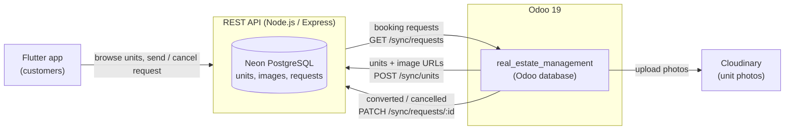
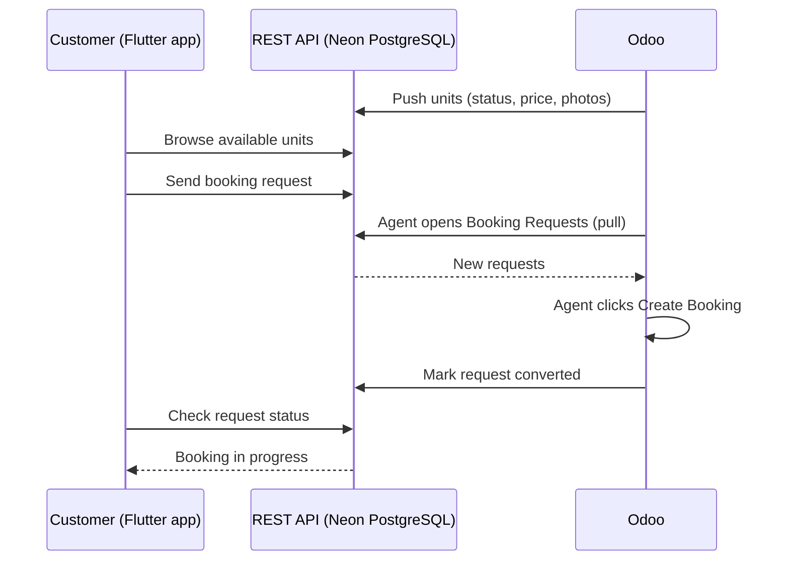
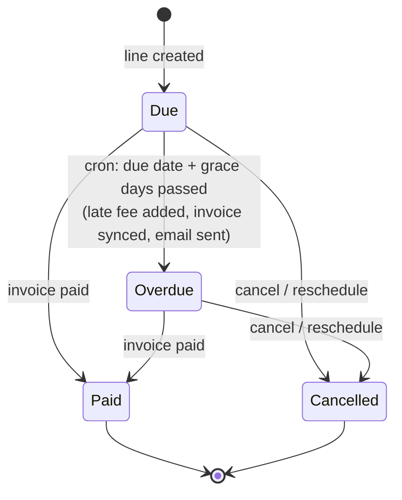
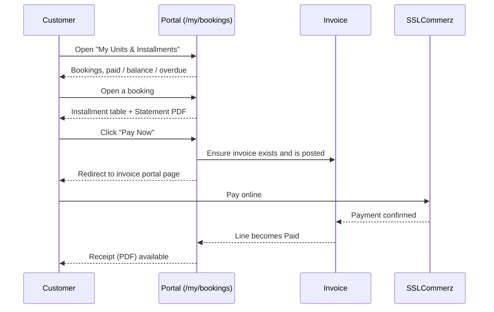
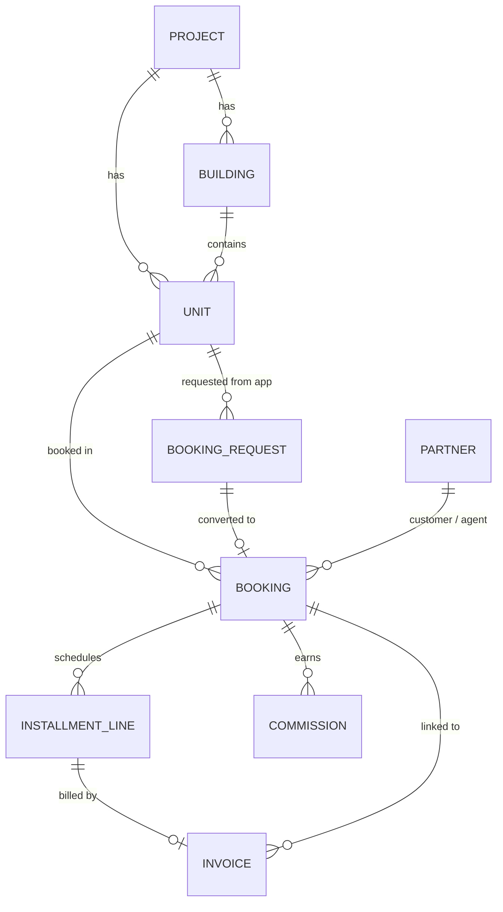

# Real Estate Installment & Property Sales Management

[](https://www.odoo.com)
[](https://www.gnu.org/licenses/lgpl-3.0)

An Odoo 19 module for developers and builders who sell **flats, plots and shops on installments**. It covers the full sales lifecycle: booking, agreement, installment plan, automatic late fees, email reminders, receipts, agent commissions, a customer portal, and online payment through **SSLCommerz**.

It also talks to the outside world through a small **REST API**. Units are pushed from Odoo to a **Flutter mobile app**, and booking requests made in the app flow back into Odoo, so data moves in both directions.

[**[See Screenshots]**](#screenshots)

---

## Features

| Area | What you get |
|------|--------------|
| **Properties** | Projects → Buildings/Blocks → Units (Flat / Plot / Shop) with sizes in Sq. Ft., Katha or Decimal, plus unit photos |
| **Booking** | Auto-numbered bookings (`BK/YYYY/00001`), pricing, discount, booking money, down payment, handover payment |
| **Installment plan** | One-click plan generation, with the last installment absorbing rounding differences |
| **Invoicing** | Every payment line gets a customer invoice, posted automatically |
| **Late fees** | Percentage-based fee applied once when a line becomes overdue, after a configurable grace period |
| **Reminders** | Daily cron sends an upcoming-due email, schedules an activity, and sends an overdue notice |
| **Receipts** | PDF payment receipts emailed automatically after payment |
| **Rescheduling** | Wizard that replaces pending installments with a new schedule |
| **Cancellation** | Wizard that releases the unit, cancels unpaid lines and commission, and calculates the refund |
| **Commission** | Agent commission is created at agreement, then goes through approval and payment |
| **Customer portal** | Customers see their units, installments and balance, then pay online and download statements and receipts |
| **Mobile app sync** | Units are pushed to a REST API for the Flutter app. Booking requests from the app are pulled into Odoo. |
| **Dashboard** | Manager dashboard with KPIs, trends, recent activity and export to CSV, PDF and Excel |
| **Reports** | Booking Slip, Unit Statement, Payment Receipt (QWeb PDF) |
| **Analytics** | Pivot and graph views for bookings and installments |
| **Security** | Three-level role hierarchy with record rules |

---

## Architecture: Odoo ↔ API ↔ Flutter

The module is not limited to the Odoo backend. A small REST API sits between Odoo and a mobile app, so data can leave Odoo and come back.



**Two databases, one flow.** Odoo keeps its own database as the source of truth for properties, bookings and payments. The API keeps a lightweight copy on **Neon PostgreSQL** that the mobile app reads from, plus the booking requests customers submit.

| Direction | What moves | How |
|-----------|-----------|-----|
| **Odoo → App** | Units (name, project, building, type, floor, size, price, status, photos) | Pushed to the API right after a unit is created, changed or deleted. A cron retries anything that failed. |
| **App → Odoo** | Booking requests (customer name, email, phone number, unit) | Odoo pulls them when **Sales → Booking Requests** is opened. |
| **Odoo → App** | Request outcome (`converted` or `cancelled`) | Pushed back when an agent creates a booking or cancels the request. Failed pushes are retried automatically. |

### Booking request flow



The same request is visible in both places: the customer sees its status in the app, and the sales team sees it in Odoo.

---

## Workflow

### Booking lifecycle


| Step | Action | What happens automatically |
|------|--------|----------------------------|
| 1. **Draft** | Agent creates a booking (or converts an app request): customer, unit, discount, booking money, payment schedule | Booking number is generated. The agent defaults to the current user if they are an agent. |
| 2. **Confirm Booking** | Validates price > 0 and booking money > 0 | Unit → `Booked`. A *Booking Money* line and invoice are created and posted. |
| 3. **Sign Agreement** *(Manager)* | Requires the booking money to be paid | Unit → `Sold`. Agreement date is stamped. Agent commission is created (rate from the agent's profile). |
| 4. **Generate Installment Plan** *(Manager)* | Builds Down Payment, N monthly Installments and Handover Payment | Dates are derived from the agreement date and interval. State → `Installment Running`. |
| 5. **Handover** *(Manager)* | Requires no `due` or `overdue` lines | State → `Handed Over`. Handover date is stamped. |
| ✖ **Cancel Booking** *(Manager)* | Wizard asks for reason and deduction % | Unpaid lines and their invoices are cancelled, unit → `Available`, open commissions are cancelled, and the refund is computed and logged. |
| **Reschedule** *(Manager)* | Wizard asks for new count, interval and first date | Pending installments are cancelled, along with their late fees, and replaced by a new set with the same total. |

Every unit status change (`Available`, `Booked`, `Sold`) is pushed to the app automatically.

### Installment line lifecycle



The line state is computed from the linked invoice's payment state, so paying through the portal, registering a payment in Accounting, or reconciling a bank statement all update it.

### Automation (scheduled actions)

| Cron | Interval | Job |
|------|----------|-----|
| `Installment reminders & overdue` | Daily | 1) Reminder email, activity and invoice for lines due within *N* days. 2) Mark lines past due plus grace as overdue, add the late fee, sync the invoice, email the customer and schedule an activity. |
| `Send payment receipts` | Every 15 min | Emails a PDF receipt for newly paid lines, up to 50 per run, and logs it in the booking chatter. |
| `Push units to app` | Every 5 min | Re-sends units that are still marked as not synced (up to 200 per run), for example after the API was unreachable. |

Each line is processed inside its own savepoint, so one failure never blocks the rest.

### Customer portal flow



---

## Dashboard

**Real Estate → Dashboard** (Managers only) shows:

- KPI cards: total units, bookings, collection, due installments, pending commissions
- Bookings & collection trend, units by type, sales by project
- Recent bookings, upcoming and overdue installments, recent activity, collection overview
- A date range picker (this month, last month, last 30 days, quarter, year or custom)
- **Export Report** as CSV, PDF or Excel

---

## Roles & Security

Roles are hierarchical. Each level inherits the one below it.

```
Manager  ──▶  Accountant  ──▶  Sales Agent  ──▶  Internal User
```

| Role | Can do |
|------|--------|
| **Sales Agent** | Create and edit own bookings, confirm drafts, view own installments and commissions, view properties, view booking requests |
| **Accountant** | See all bookings, installments and commissions. Create invoices, send reminders and receipts, waive late fees. |
| **Manager** | Everything: agreements, plans, handover, reschedule, cancel, commission approval, properties, dashboard, settings |
| **Portal customer** | Read-only access to their own bookings and installments |

Record rules restrict agents and customers to their own records. The installment-pay and receipt portal routes rely on these rules. Report and invoice operations run with `sudo()` only after the access check.

The API is protected by two separate secrets: one used by Odoo and one used by the mobile app. Neither is shared with the other side.

The installer automatically adds the **Admin** user to the Real Estate Manager group.

---

## Configuration

**Real Estate → Configuration → Settings**

| Setting | Default | Meaning |
|---------|---------|---------|
| Late Fee (%) | `2.0` | Charged once on the installment amount when it becomes overdue |
| Grace Period (days) | `0` | Days after the due date before a line is marked overdue |
| Reminder (days before due) | `3` | Reminder email lead time |
| Cancellation Deduction (%) | `10.0` | Default deduction from the paid amount on cancellation |
| App API URL | empty | Base URL of the REST API, for example `https://your-api.onrender.com` |
| App API Secret | empty | Must match `SYNC_SECRET` on the API server |
| Cloudinary Cloud Name / API Key / API Secret | empty | Used to store unit photos. Photos are resized, uploaded on save, and removed when deleted. |

Also, mark agents on their contact form under the **Real Estate** tab (*Real Estate Sales Agent* + *Commission Rate %*).

Mobile sync is optional. If the API URL and secret are empty, Odoo works exactly as a standalone module.

---

## Installation

### Requirements

- Odoo **19.0**
- Odoo apps: `base`, `mail`, `account`, `portal`, `payment`, `account_payment`
- An Odoo `payment_sslcommerz` provider module, available in your addons path
- Python packages `requests` and `xlsxwriter` (normally already installed with Odoo)

> The manifest depends on `payment_sslcommerz`. If you do not use SSLCommerz, remove it from `depends` in `__manifest__.py`. Everything else still works with any other payment provider.

### Steps

```bash
# 1. Clone into your custom addons directory
git clone https://github.com/TanvirAhmedCSE/real_estate_management.git /path/to/custom_addons/real_estate_management

# 2. Add the directory to addons_path in odoo.conf
#    addons_path = /opt/odoo/addons,/path/to/custom_addons

# 3. Restart Odoo and install
./odoo-bin -c odoo.conf -d <your_db> -i real_estate_management
```

Or: **Apps → Update Apps List → search "Real Estate" → Install**.

---

## REST API (Node.js + Neon PostgreSQL)

A small Express service that bridges Odoo and the Flutter app. It stores a synced copy of the units, their images and the booking requests in **Neon PostgreSQL**.

| Endpoint group | Used by | Header |
|----------------|---------|--------|
| `GET /units`, `GET /units/:id`, `POST /units/:id/requests`, `GET /requests/:id`, `POST /requests/:id/cancel` | Flutter app | `x-app-key` |
| `POST /sync/units`, `GET /sync/requests`, `PATCH /sync/requests/:id` | Odoo | `x-sync-secret` |

How it works: the API never creates units on its own. Odoo is the source of truth and pushes every unit change to it, and the API simply stores that copy in Neon PostgreSQL for the app to read. Booking requests work the other way around. The app writes them to the API, and Odoo pulls them in and reports back the result. Odoo reaches the API through the App API URL and secret in its settings, and the app uses its own key, so the two sides stay separate.

---

## Flutter App

A customer-facing mobile app that reads everything from the API:

- Browse the units published from Odoo, with photos, price, size, floor and live status
- Search, filter by size, price, type and floor, and save favourites
- Send a **booking request** with name, email and phone number, and cancel it while it is still pending
- See the request status update once the sales team acts on it in Odoo

A request sent from the app appears in Odoo under **Sales → Booking Requests**. The agent turns it into a booking with one click, and the app reflects the result.

---

## Tests

```bash
./odoo-bin -c odoo.conf -d <test_db> -i real_estate_management \
    --test-tags /real_estate_management --stop-after-init
```

The suite covers:

- Full plan generation: booking → payment → agreement → commission → installments
- Overdue cron: late fee calculation and invoice sync
- Cancellation wizard: unit release and state change

---

## Module Structure

```
real_estate_management/
├── __init__.py                  # post_init_hook (admin → manager)
├── __manifest__.py
├── controllers/
│   └── portal.py                # /my/bookings, statement, pay, receipt
├── data/
│   ├── sequence_data.xml        # BK/YYYY/00001
│   ├── mail_template_data.xml   # reminder, overdue, receipt emails
│   └── cron_data.xml            # reminders, receipts, push units
├── models/
│   ├── project.py               # Project & Building
│   ├── unit.py                  # Flat / Plot / Shop, images, app sync
│   ├── booking.py               # Core workflow
│   ├── booking_request.py       # Requests pulled from the app
│   ├── installment_line.py      # Lines, invoicing, late fees, crons
│   ├── commission.py
│   ├── dashboard.py             # Dashboard data, Excel and PDF export
│   ├── api_client.py            # Calls to the REST API
│   ├── cloudinary_client.py     # Unit photo upload / delete
│   ├── ir_attachment.py         # Cloudinary fields on attachments
│   ├── res_partner.py           # Agent fields
│   ├── account_move.py          # Links invoice ↔ booking / line
│   └── res_config_settings.py
├── wizard/
│   ├── reschedule_wizard.py
│   └── cancel_wizard.py
├── report/
│   ├── report_actions.xml
│   └── report_templates.xml     # Booking slip, statement, receipt, dashboard
├── security/
│   ├── security.xml             # Groups & record rules
│   └── ir.model.access.csv
├── static/src/dashboard/        # OWL dashboard (JS, XML, SCSS)
├── views/                       # Backend views, menus, portal templates
├── demo/demo.xml                # Sample data (enable in the manifest)
└── tests/
    └── test_installment.py
```

---

## Data Model



---

## Screenshots


---

## Notes

- Each installment line is billed by its own customer invoice. Paid state follows the invoice, so partial payments do not mark a line paid.
- A line with a (partial) payment cannot be cancelled until the payment is reversed.
- The cancellation refund is **recorded** on the booking and its chatter. The actual refund payout is handled manually in Accounting.
- The late fee is charged **once** per line. Waive it from the installment form (Accountant+).
- Odoo owns the `converted` state of a booking request. The app can only cancel a request that is still pending.
- If the API is unreachable, nothing is lost: units stay marked as not synced and are retried by the cron, and request status updates are retried the next time Booking Requests is opened.

---

## License

Distributed under the **LGPL-3** license.
